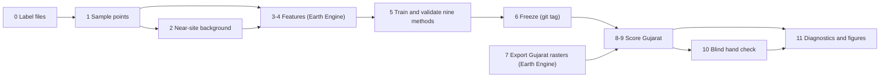
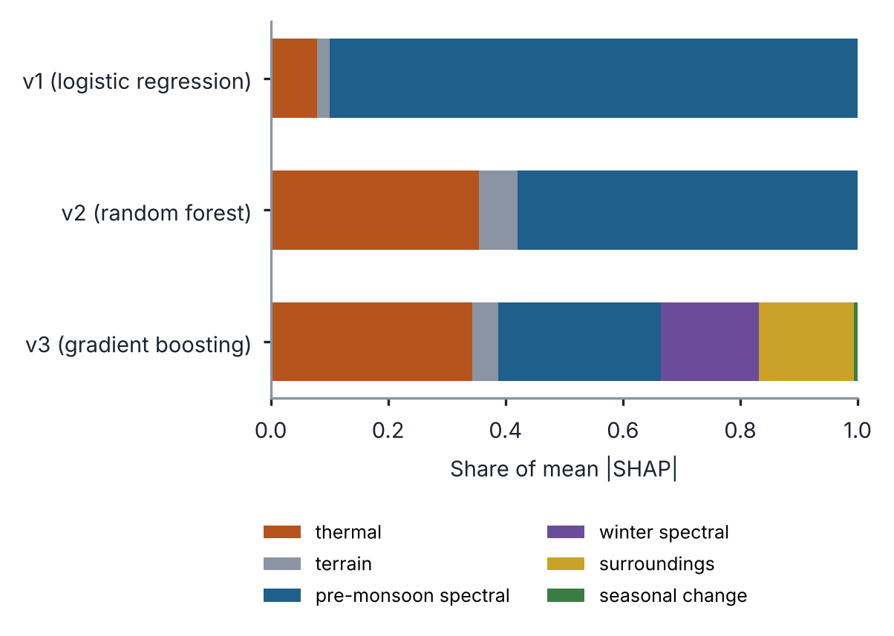

# Landfill detection in Gujarat from free satellite data

ES 678 course project (graduate track), Amitesh Kumar, IIT Gandhinagar.

Balanced Scores, Rare Targets: How Validation Design and Prevalence Change Satellite Dumpsite Detection

**Paper:** [Amitesh_Kumar_24210011_ML_project_Report.pdf](Amitesh_Kumar_24210011_ML_project_Report.pdf), with its LaTeX source in the same folder.

---

## 1. Research Questions

The unit of prediction is one 10 m pixel. The target is 1 if the pixel lies on visible, active waste in March–May 2024, and 0 otherwise. A prediction uses only imagery up to May 2024 and no Gujarat labels. A flagged pixel is a candidate for a human to check, not a confirmed dumpsite.

| # | Question | Short answer |
| --- | --- | --- |
| Q1 | Does a model trained only outside Gujarat find Gujarat's known dumpsites? | **Yes.** It found 16 of 17 sites on the first sealed list and 5 of 6 on a second list of new cities. However, it also flagged about 5% of all scored land, and only 5 of its 100 strongest alarms were dumps. |
| Q2 | How much does the validation design change the score? | **A lot for some models.** Random forest falls from F1 0.907 (random pixels) to 0.736 (whole regions held out), and under random-pixel validation it would have been selected. Gradient boosting only falls from 0.815 to 0.762. Region-held-out validation predicted the Gujarat pixel-level behaviour well (F1 about 0.70 at the same class mix). |
| Q3 | What precision should a user expect when dumpsites are rare? | **Very low.** With the validation rates, expected pixel precision is 96% when half the land is dump, 21% at 1% and 2.6% at 0.1%. In Gujarat, dump outlines are 0.024% of the scored pixels, and the measured pixel precision is 0.35%. The false-alarm rate, not recall, decides precision. |

---

## 2. Main results

Version 3 is the final model: gradient boosting with 26 features and a threshold of 0.5.
| | |
| --- | --- |
| Training data | 34,345 labelled pixels from 86 landfill places in 26 states and 60 look-alike places (3,853 landfill, 24,989 near-site background, 3,764 random background, 1,739 look-alike) |
| Model | Gradient boosting (scikit-learn defaults, class-balanced weights, threshold 0.5), selected by a rule fixed in advance: best mean F1 with whole regions held out |
| Validation, held-out region | F1 0.762 ± 0.044 (precision 0.694, recall 0.865); the published threshold rule scores 0.415 |
| Gujarat, first sealed list | 16 of 17 sites found; Rajkot missed (48.6% of its outline flagged, just under the 50% rule) |
| Gujarat, six new cities (the clean test) | 5 of 6 found; Porbandar missed (18.5% flagged) |
| Land flagged | 5.2% of 12,854 km² (7,801 alarm patches); 4.0% of 5,244 km² in the new cities (2,791 patches) |
| Ranking | With the sealed sites left in, known sites hold 5 of the top 50 and 8 of the top 100 patches. An unlisted landfill at Surendranagar ranks 4th |
| Hand check of the top 100 alarms | 5 dumps (3 previously unknown), 94 look-alikes, 1 unsure: precision 5/99 = 5.1% (95% CI 1.7–11.4%) |
| Pixel precision against the sealed lists | 0.35% (first list), 0.064% (new cities). These are lower bounds, because unlisted dumps count as false alarms |

---

## 3. Three versions

Versions 1 and 2 are kept for transparency, because the way they failed motivated the next version.

| | Version 1 (`freeze-v1`) | Version 2 (`freeze-v2`) | Version 3 (`freeze-v3`) |
| --- | --- | --- | --- |
| What changed | The original plan: 12 features, 9,530 points | Added 25,800 near-site background points from around the training landfills | Added 14 features: a winter season and each pixel's surroundings (26 in all) |
| Model selected | Logistic regression | Random forest | Gradient boosting |
| First-list sites found | 16 of 17 | 15 of 17 | 16 of 17 |
| Land flagged | 5.5% | 1.8% | 5.2% |
| Known sites in the top 100 patches | not recorded | 4 | 8 |
| What the top alarms were | 0 dumps among 50 checked: 33 blue roofs, 5 water | Large bare-land patches | 5 dumps among 100 checked; mostly bare soil |

- **Version 1** failed as a detector. A linear model gave extreme scores to blue metal roofs, which were absent from its training data. Those alarms *were* out-of-distribution (20–26% beyond the 99th percentile).
- **Version 2** removed the roofs by adding background from towns and coasts near the training landfills, but ranked known sites below large bare fields.
- **Version 3** adds what a person uses to tell a field from a dump: how the place looks in another season, and what surrounds it.

**Disclosure.** Version 3's design responded to the failures seen on the first 17-site list. The first list is therefore no longer an unseen test for it. A second list of six sites in six new cities was sealed afterwards and scored once with the frozen version 3 model. **That list is the clean test.** No Gujarat data entered any version's training.

---

## 4. Safeguards against test leakage

- **Sealed test lists.** Each Gujarat list was committed before any model was run on it: commit `8711855` for the 17-site list and `fc81cd5` for the six new cities.
- **Freeze tags.** The tags `freeze-v1`, `freeze-v2` and `freeze-v3` mark the commits that fixed each model, its threshold and its scoring rules. Each tag was pushed before scoring. `score_gujarat.py` refuses to run unless the model file matches the tagged one.
- **Rules written down first.** [`docs/freeze.md`](docs/freeze.md), [`freeze_v2.md`](docs/freeze_v2.md) and [`freeze_v3.md`](docs/freeze_v3.md) record what each freeze fixed and what would count as success, before the corresponding scoring.
- **No Gujarat data in training.** No Gujarat pixel, label or hand-check verdict was used for training or model selection. False alarms seen in Gujarat were *not* added as negatives.
- **No tuning.** All models use scikit-learn defaults and a fixed threshold of 0.5. The only learned preprocessing (standardisation inside logistic regression) is fit inside each training fold.
- **Blind hand check.** The top 100 alarms were given shuffled IDs, so the checker could not see a pin's rank or score.

---

## 5. The pipeline on one page



| # | Step | Script | Runs on | Needs | Time | Main output |
| --- | --- | --- | --- | --- | --- | --- |
| 0 | Label files | given (see step 0) | — | — | — | `labels/` |
| 1 | Sample points | `build_samples.py` | your computer | nothing | 2 s | `data/samples/points.csv` (9,530 points) |
| 2 | Near-site background | `build_background_v2.py` | your computer | step 1 | 15 s | `points_v2_background.csv` (25,800 points) |
| 3 | 12 base features | `gee_features.py` | Earth Engine | account | ~15 min | `data/features/`, `data/features_v2/` |
| 4 | 10 extra features | `gee_features.py --stack extra` | Earth Engine | account | ~15 min | `data/features_v3/` |
| 5 | Train and validate | `run_models.py` | your computer | steps 3–4 or stored tables | ~20 min (4 cores) | `data/results_v3/` |
| 6 | Freeze | `freeze_model.py` | your computer | step 5 | 20 s | `model.joblib` |
| 7 | Export Gujarat rasters | `gee_export_gujarat.py` | Earth Engine + Drive | account, ~12 GB Drive | 1–3 h, mostly waiting | 28 GeoTIFFs |
| 8 | Score the first list | `score_gujarat.py --version 3` | your computer | steps 6–7 | ~15 min | `data/gujarat_results_v3/` |
| 9 | Score the new cities | `score_gujarat.py --version 3` | your computer | steps 6–7 | ~5 min | `data/gujarat_results_v3_new/` |
| 10 | Blind hand check | by eye, Google Earth Pro | you | step 8 | ~2 h | `blind_check.csv` |
| 11 | Diagnostics and figures | `diagnostics.py`, `alarm_diagnostics.py`, `paper_figures.py` | your computer | stored files | a few min | `data/analysis/`, `figures/`, `docs/Paper/figures/` |

Every intermediate file except the Gujarat feature rasters is stored in the repository. At each step you can either **rebuild and compare** with the stored copy, or **skip** and use the stored copy. Without an Earth Engine account you can still run steps 1, 2, 5, 6 and 11 and reproduce every validation number.

---

## 6. Setup

### 6.1 Requirements

- Python 3.13 (3.11 or 3.12 should work; the models were trained with 3.13).
- About 15 GB of free disk if you rebuild the Gujarat rasters; 1 GB otherwise.
- For steps 3, 4 and 7 only: a free [Google Earth Engine](https://earthengine.google.com) account registered to a Cloud project, and about 12 GB of Google Drive space.
- For step 10 only: [Google Earth Pro](https://www.google.com/earth/about/versions/) (free).

### 6.2 Get the code and install the libraries

```bash
git clone https://github.com/wre9-tesh/ML_Landfill_Detection.git
```

```bash
cd ML_Landfill_Detection
```

```bash
python -m venv .venv
```

Activate the environment. On Windows PowerShell, run `.\.venv\Scripts\Activate.ps1`. On macOS or Linux, run:

```bash
source .venv/bin/activate
```

```bash
python -m pip install -r requirements.txt
```

All later commands are typed from the repository root with the environment active. The commands below are single lines, so they work unchanged in bash and PowerShell.

| Library | Version | Used for |
| --- | --- | --- |
| scikit-learn | 1.9.1 (pinned exactly: a saved model must be opened with the version that wrote it) | The nine methods |
| numpy, pandas, scipy | 2.5.3, 3.0.5, 1.18.1 | Arrays, tables, patch labelling |
| joblib | 1.6.0 | Saving the frozen model |
| rasterio | 1.5.2 | Reading and writing GeoTIFFs |
| earthengine-api | 1.7.52 | Talking to Earth Engine |
| shap, matplotlib | 0.54.1, 3.11.2 | Diagnostics and figures |

### 6.3 Earth Engine (steps 3, 4 and 7 only)

Register a Cloud project for non-commercial use at [code.earthengine.google.com](https://code.earthengine.google.com) and note its ID (it looks like `my-project-123456`). Below it is written `YOUR-PROJECT-ID`. Then link your computer to the account; a browser window opens:

```bash
earthengine authenticate
```

Test it:

```bash
python -c "import ee; ee.Initialize(project='YOUR-PROJECT-ID'); print(ee.Number(1).add(1).getInfo())"
```

It should print `2`. The project ID is passed on the command line and never stored in the repository.

### 6.4 How to check your output

- **Steps that rewrite a stored file** (1, 2, 5, 6, 11): run `git status --short data`. No output means your files are byte-for-byte identical to the stored ones. On Windows, if a file is listed but `git diff --ignore-cr-at-eol --stat data` prints nothing, only line endings differ.
- **Steps that fetch from Earth Engine** (3, 4, 7, 8, 9): write into the folder `rep/` (ignored by Git), then compare with the stored copy using `scripts/compare_tables.py` as shown in each step.
- **To restore the stored files** at any time, run `git checkout -- data figures`.

---

## 7. Step-by-step replication

### Step 0. The label files (given)

Nothing to run. These files are the project's raw material, and everything later is computed from them. Collecting them was manual work in Google Earth Pro. [`docs/methods.md`](docs/methods.md) gives the full rules.

| File | Rows | What it holds |
| --- | --- | --- |
| `data/raw/osm_landfill_india.geojson` | 917 | OpenStreetMap features tagged `landuse=landfill` in India (Overpass snapshot of 3 November 2026; the query is in `docs/methods.md`) |
| `labels/india_screening.csv` / `.kml` | 843 | One row per OSM candidate outside Gujarat. The columns `decision` (`keep`, `drop`, `unsure`, blank) and `reason` record what was seen on 2024 imagery |
| `labels/extra_sites.csv` / `.geojson` | 82 | Active municipal dumpsites not in OSM, outlined by hand |
| `labels/gujarat_test_sites.csv` / `.geojson` | 17 (+1 pin) | **First sealed list:** 17 outlined dumpsites in 13 Gujarat cities, all ≥ 1 ha. The pin without an outline (Surat LF-3) is never scored |
| `labels/gujarat_new_sites.csv` / `.geojson` | 6 | **Second sealed list:** 6 dumpsites in 6 further cities |
| `labels/gujarat_boxes.json` | 14 | The rectangles scored for the first list, exactly as exported |
| `data/boundaries/geoBoundaries-IND-ADM1_simplified.geojson` | 36 | State boundaries, used only to assign points to states and keep Gujarat out |

How a screening row is used:
- `keep` makes the outline a landfill.
- `drop` with reason `ash_pond`, `bare_soil` or `quarry` (and the other look-alike reasons in `docs/methods.md`) makes it a **look-alike**, an example of what is not a landfill.
- Every other row gives no points.

The most important rule is that a landfill counts only if active dumping is visible in imagery from March to May 2024, the window the features come from.

Two helper scripts made these files and are kept for reference:
- `scripts/osm_to_screening.py` turns the OSM export into the screening sheet. Write to `--out rep/labels` if you rerun it, so you do not overwrite the screening decisions.
- `scripts/kml_to_csv.py` converts outlines saved from Google Earth into the label CSVs.

### Step 1. Sample points

A model learns from pixels, not outlines. This step turns the label files into 9,530 points, each with a longitude, latitude and label.

```bash
python scripts/build_samples.py
```

Expected output (first lines):

```text
Screening rows: 843; decisions: (blank) 736, drop 93, keep 13, unsure 1
Points: 9530 (site 3865, lookalike 1800, random 3865)
Site places: 86 (OSM 11, extra 75)
Look-alike places by class: ash_pond 32, bare_soil 16, quarry 12
...
States with their own fold: 1 -> fewer than 5, so folds become Zonal Council regions: Central 16, Eastern 14, North-Eastern 5, Northern 23, Southern 13, Western 15
```

**Check:** `git status --short data/samples` prints nothing.

What the script does:
1. Kept OSM rows and hand-drawn outlines become landfill places, and look-alike drops become look-alike places.
2. Outlines within 500 m of each other are merged into one *place*, so one landfill cannot sit on both sides of a validation split.
3. Hand-drawn places under 1 ha (about one native Landsat thermal pixel) give no points.
4. It draws up to 50 points per landfill place and 30 per look-alike place. Each point is at least 15 m inside the outline and at least 15 m from the next one.
5. It draws as many random background points as landfill points, shared between source states, never within 500 m of a mapped site and never in Gujarat.
6. Each point gets its state. Only Maharashtra has the 10 places needed for its own fold, so validation uses India's six Zonal Council regions.

| Setting | Value | Why |
| --- | --- | --- |
| `--n-site`, `--n-lookalike` | 50, 30 | One 300 ha landfill must not outweigh thirty 3 ha ones |
| `--edge-m`, `--spacing-m` | 15, 15 | Edge pixels mix waste with surroundings; no 10 m pixel is sampled twice |
| `--exclude-m` | 500 | An unmapped part of a landfill cannot become background |
| `--merge-m`, `--min-ha` | 500, 1.0 | Steps 2 and 3 above |
| `--holdout` | `IN-GJ` | Gujarat is never sampled |
| `--seed` | `es678` | Each place and state has its own seeded stream, so adding a site leaves the other points unchanged |

### Step 2. Near-site background points

The random points of step 1 fall mostly on farmland and forest, while Gujarat is scored in boxes around cities, full of roofs, roads, water and coast. This step draws 300 "not a landfill" points in a box 15 km around each of the 86 training landfills, giving 25,800 points from the same kind of land that is scored in Gujarat.

```bash
python scripts/build_background_v2.py
```

```text
25800 points around 86 landfill places written to .../data/samples/points_v2_background.csv
  per state: IN-MH 4500, IN-PB 2100, IN-RJ 1800, ...
```

**Check:** `git status --short data/samples` prints nothing.

Draws within 500 m of any mapped site, in Gujarat, or in Dadra and Nagar Haveli and Daman and Diu are rejected. Each point takes the state of the landfill it surrounds, so a held-out region takes its own surroundings with it. The seed is `es678-v2`.

### Step 3. The twelve base features (Earth Engine)

For every point, Earth Engine computes twelve numbers describing the ground in March–May 2024. Run a 50-point test first, then the two full fetches:

```bash
python scripts/gee_features.py --project YOUR-PROJECT-ID --out rep/features --limit 50
```

```bash
python scripts/gee_features.py --project YOUR-PROJECT-ID --out rep/features
```

```bash
python scripts/gee_features.py --project YOUR-PROJECT-ID --out rep/features_v2 --points data/samples/points_v2_background.csv
```

```text
9530 points: 50 already fetched, 9480 to fetch now in 32 batches of up to 300
  batch 1/32: 300/300 points in <n> s
  ...
done in <n> s: 9530/9530 points fetched
wrote .../rep/features/features.csv
```

If the run stops, run the same command again: fetched points are cached in `cache.csv` and are not fetched twice. A batch that Earth Engine refuses is split in half and retried automatically.

**Check:**

```bash
python scripts/compare_tables.py data/features/features.csv rep/features/features.csv
```

```bash
python scripts/compare_tables.py data/features_v2/features.csv rep/features_v2/features.csv
```

The comparison should end with `identical within tolerance`. Google occasionally reprocesses its archives, so a few points may differ slightly (see section 8).

| Feature | Source and processing | Why |
| --- | --- | --- |
| `B2 B3 B4 B8 B11` | Sentinel-2 surface reflectance (blue, green, red, NIR, SWIR); median of scenes under 10% cloud, 1 Mar–31 May 2024, with cloud, shadow, cirrus, snow and defective pixels masked | Surface colour, including two bands the eye cannot see |
| `NDVI` | (B8 − B4) / (B8 + B4) | High on vegetation, low on waste |
| `NDBI` | (B11 − B8) / (B11 + B8) | High on built-up and disturbed ground |
| `BSI` | ((B11 + B4) − (B8 + B2)) / ((B11 + B4) + (B8 + B2)) | Bare-soil index |
| `LST` | Landsat 8/9 surface temperature (°C), median of scenes under 30% cloud, bilinear to 10 m | Decomposing waste runs hot |
| `LST_anom` | LST minus the mean LST of land within 2 km (computed at 100 m, permanent water from JRC excluded) | "Hotter than its surroundings" means the same in every climate |
| `elev`, `slope` | SRTM elevation (m) and slope (°) | Separates plains from hills and quarry faces |

Points whose pixel is masked in every scene come back empty (58 of 9,530 and 66 of 25,800 in the stored tables, mostly Himalayan snow); training drops them. Every setting is recorded in `features_meta.json` next to each table.

### Step 4. The ten extra features (Earth Engine)

Version 3 adds a second season and a description of each pixel's surroundings.

```bash
python scripts/gee_features.py --project YOUR-PROJECT-ID --stack extra --out rep/features_v3/main
```

```bash
python scripts/gee_features.py --project YOUR-PROJECT-ID --stack extra --out rep/features_v3/background --points data/samples/points_v2_background.csv
```

**Check:**

```bash
python scripts/compare_tables.py data/features_v3/main/features.csv rep/features_v3/main/features.csv
```

```bash
python scripts/compare_tables.py data/features_v3/background/features.csv rep/features_v3/background/features.csv
```

| Feature | Definition | Why |
| --- | --- | --- |
| `B2_w B11_w NDVI_w NDBI_w BSI_w` | The same Sentinel-2 median for 15 Nov 2023–14 Feb 2024 (winter crop season) | A field bare in March–May is green in winter; a dump is not |
| `NDVI_ctx NDBI_ctx BSI_ctx` | Mean of the pre-monsoon index within 150 m | What surrounds the pixel |
| `NDVI_sd B11_sd` | Standard deviation within 50 m | How mixed the surface is |

Four more features are computed during training, not fetched: `dNDVI` and `dBSI` (winter minus pre-monsoon), and `NDVI_rel` and `NDBI_rel` (pixel minus its 150 m mean). That makes 26.

### Step 5. Train and validate the nine methods

This is the machine-learning step. Nine methods are trained and tested under three validation designs, and one is selected by a rule fixed in advance. If steps 3–4 reported "identical within tolerance", train on the stored tables, as below, so your numbers can be checked exactly. To train on your own fetched tables, replace `data/` with `rep/` in the four table paths and write to `--out rep/results_v3`.

```bash
python scripts/run_models.py --features data/features/features.csv data/features_v2/features.csv --extra data/features_v3/main/features.csv data/features_v3/background/features.csv --rule best --out data/results_v3
```

```text
34345 points with all 26 features (985 left out for missing values); 3853 landfill, 30492 other
  held_out_region    flag_nothing         mean F1 0.000
  held_out_region    published_rule       mean F1 0.415
  ...
  held_out_region    gradient_boosting    mean F1 0.762
  ...
headline held_out_region: best mean F1 gradient_boosting; selected gradient_boosting
```

**Check:** `git status --short data/results_v3` prints nothing. The readable table is `data/results_v3/results.md`.

**The three validation designs.** A fold is a part of the data hidden during training and used for testing.

| Design | Folds | Role |
| --- | --- | --- |
| Held-out region | 6, one per Zonal Council region (Northern, Central, Eastern, Western, Southern, North-Eastern) | **Headline and selection.** Closest to the real task: a new part of India |
| Held-out site | 5, all points of a place kept together | Contrast only |
| Random pixel | 5, random points | Contrast only; flattering, because neighbouring pixels of one landfill land on both sides |

**The nine methods.** All use scikit-learn defaults, class-balanced weights (landfill and non-landfill count equally), a threshold of 0.5 on the model score and random seed 678. Nothing is tuned.

| Method | Settings |
| --- | --- |
| Flag nothing | Predicts "not a landfill" everywhere (F1 = 0) |
| Published rule | NDBI > 0.028, NDVI < 0.15, LST > 37 °C (Bhajantri and Mandpe, 2026) |
| Recalibrated rule | The same three tests, with cut-offs refit on the training folds |
| Logistic regression | On standardised features (scaler fit inside each fold), up to 1,000 iterations |
| Decision tree | Fully grown |
| Bagged trees | 200 trees |
| Random forest | 500 trees |
| AdaBoost | 200 stumps |
| Gradient boosting | 100 trees of depth 3, learning rate 0.1 |

**Selection rule**, fixed before any result: the best mean F1 on the held-out-region split. Precision, recall and F1 of the landfill class are reported as mean ± SD across folds.

| Output file | What it holds |
| --- | --- |
| `results.md` | All tables, ready to read |
| `summary.csv` | Mean and SD of precision, recall, F1 for every method and split |
| `fold_metrics.csv` | The same per fold, with the share of each background kind flagged |
| `oof_predictions.csv` | Each point's score from the round in which its region was hidden |
| `selection.json` | The selected model, folds, feature list and input tables |

### Step 6. Freeze the selected model

The selected model is trained once more on all 34,345 points and saved.

```bash
python scripts/freeze_model.py --results data/results_v3
```

```text
saved gradient_boosting, trained on 34345 points, to data/results_v3/model.joblib
```

**Check:** `git status --short data/results_v3` prints nothing, which means your model file is byte-for-byte the tagged one. If `model.joblib` shows as changed, restore it with `git checkout -- data/results_v3` before scoring, because the scoring script accepts only the tagged file.

`model.json` records the model name, its 26 features in order, the threshold, the derived features and the scikit-learn version. In the original run, the commit holding this model was tagged `freeze-v3` and pushed before Gujarat was scored. You do not need to create a tag, because your clone already has it.

### Step 7. Export the Gujarat rasters (Earth Engine)

Scoring needs the features at every pixel of the scored boxes, about 134 million pixels for the first list. Earth Engine computes them and writes GeoTIFFs (10 m, UTM zone 43N, one band per feature) to your Google Drive. The export uses the same `feature_image()` function as the training points, so training pixels and Gujarat pixels cannot be computed differently.

List the boxes first; this needs no account:

```bash
python scripts/gee_export_gujarat.py --dry-run --boxes labels/gujarat_boxes.json
```

```text
  Ahmedabad    72.4003,22.8258 to 72.7138,23.1162  32 x 32 km  10.4 M pixels
  ...
14 boxes, 134 M pixels, about 6.4 GB before compression
```

Start the two exports, the twelve base bands and then the ten extra bands:

```bash
python scripts/gee_export_gujarat.py --project YOUR-PROJECT-ID --boxes labels/gujarat_boxes.json
```

```bash
python scripts/gee_export_gujarat.py --project YOUR-PROJECT-ID --boxes labels/gujarat_boxes.json --stack extra
```

Watch progress (add `--stack extra` for the second set):

```bash
python scripts/gee_export_gujarat.py --project YOUR-PROJECT-ID --status
```

When every task says `COMPLETED`, download the files from the Drive folder `landfill_gujarat`:
- the 14 files `gujarat_<city>.tif` go into `data/gujarat/`;
- the 14 files `gujaratx_<city>.tif` go into `data/gujarat_x/`.

With little Drive space, run the first export, then download and delete those files before starting the second. Git ignores these `.tif` files.

**For the six new cities**, export boxes 15 km around the second list into separate folders. Use `--dry-run` first to see the six boxes:

```bash
python scripts/gee_export_gujarat.py --project YOUR-PROJECT-ID --sites labels/gujarat_new_sites.csv
```

```bash
python scripts/gee_export_gujarat.py --project YOUR-PROJECT-ID --sites labels/gujarat_new_sites.csv --stack extra
```

Download these into `data/gujarat_new/` and `data/gujarat_new_x/`. Exports rewrite `export_meta.json` in `data/gujarat/` and `data/gujarat_x/` with your own task numbers. Restore the stored copies afterwards with `git checkout -- data/gujarat data/gujarat_x`.

**Why the boxes come from a file.** Each box reaches 15 km beyond one city's sealed sites, so it holds towns, farmland, industry and coast in their real proportions, not only the land around a dump. Two boxes cannot be recomputed from the current list. The Surat box was drawn while the list still held a pin later removed, and Surendranagar is a fourteenth box around a landfill that is on neither list. The 13 city boxes cover 11,914 km²; with Surendranagar the scored area is 12,854 km², about 6.6% of Gujarat. **Land outside the boxes is not scored.**

### Step 8. Score the first sealed list

The frozen model gives every pixel a score. The script then reports which sealed sites were found, how much land was flagged and where the alarms are.

```bash
python scripts/score_gujarat.py --version 3 --out rep/gujarat_results_v3
```

```text
  ahmedabad    8.39% of scored pixels flagged
  ...
  "site_patches_in_top_50": 5,
  "site_patches_in_top_100": 8,
  "sites_counted": 17,
  "sites_found": 16,
  "pixels_scored": 128541406,
  "pixels_flagged": 6662452,
  "share_flagged": 0.05183,
  "area_scored_km2": 12854.1,
  "alarms": 7801
```

If it stops with `This commit has no freeze tag for version 3`, the model file is not the tagged one. Run `git checkout -- data/results_v3` and try again.

**Check:** compare `rep/gujarat_results_v3/site_recall.csv` with `data/gujarat_results_v3/site_recall.csv`. The only site missed should be `RAJ-01` (Rajkot), with 0.4859 of its outline flagged.

**Scoring rules**, fixed in the freeze notes:

| Rule | Value | Why |
| --- | --- | --- |
| Flagged | Model score ≥ 0.5 | The frozen threshold |
| Found | At least 50% of the outline's scored pixels flagged | "One flagged pixel" would be met by chance when 5% of land is flagged |
| Alarm | Edge-touching (4-connected) flagged pixels outside the sealed outlines, at least 1 ha (100 pixels) | A person checks places, not pixels |
| Rank | Mean score of the patch | Ranking by area × score (tried in version 2) put the biggest bare fields first |
| Overlaps | A pixel in two boxes is counted once, in the first city alphabetically | No double counting |

| Output file | What it holds |
| --- | --- |
| `summary.json` | The headline counts and settings |
| `site_recall.csv` | Per sealed site: pixels, share flagged, highest score, found or missed |
| `areas.csv` | Per box: pixels scored and share flagged |
| `alarms.csv` | Every alarm: rank, centre, area, mean score |
| `site_ranks.csv` | Where each sealed site's patch would rank if the sites were left in the alarm list |
| `alarms_blind.kml` | The top 100 alarms as pins with shuffled IDs, for the hand check |
| `scores/<city>.tif` | Score maps, 0–100 per pixel, 255 where a feature is missing (stored in the repository) |

### Step 9. Score the six new cities (the clean test)

The same frozen model, rules and threshold are applied to the second sealed list:

```bash
python scripts/score_gujarat.py --version 3 --sites labels/gujarat_new_sites.geojson --tifs data/gujarat_new --extra-tifs data/gujarat_new_x --out rep/gujarat_results_v3_new
```

**Check:** against `data/gujarat_results_v3_new/`, 5 of 6 sites should be found, with Porbandar (`GJ03`) missed at 0.1847 flagged, and 2,791 alarms over 5,243.6 km².

### Step 10. Check the top alarms by eye

How many of the strongest alarms are real dumps is the number a user of the map cares about, and only a person can produce it.

1. Open `alarms_blind.kml` in Google Earth Pro. A hundred pins appear, named `A001` to `A100` in shuffled order, so a pin's name says nothing about its rank or score.
2. For each pin, use the historical-imagery slider to look at 2023–2025 imagery.
3. Record one row per pin with the columns `blind_id, verdict, class, notes, seen`.

| Column | What to write |
| --- | --- |
| `verdict` | `Dump` if about 1 ha or more of accumulated waste is visible; `look_alike` if not; `Unsure` only if the imagery cannot settle it |
| `class` | For a look-alike: `construction`, `bare_soil`, `industrial`, `riverbed`, `ash_pond`, `quarry` or `other` |
| `seen` | What is actually there, e.g. `bare_soil`, `field_or_grass`, `building`, `blue_roof`, `industrial_plant` |

The sheet used in the project is `data/gujarat_results_v3/blind_check.csv`; version 1's is `data/gujarat_results/blind_check.csv`. This step is a human judgement and cannot be reproduced exactly.

### Step 11. Diagnostics and figures

**11.1 Training data and the three frozen models** (needs only the stored tables, about 90 s):

```bash
python scripts/diagnostics.py
```

It writes `data/analysis/diagnostics.md`, the `diag_*.csv` tables and three figures in `figures/`. It answers four questions:
- **Separability, one feature at a time:** for each feature and each background class, the AUC.
- **Separability, all features together and without a model:** for each point, the share of landfill among its 15 nearest neighbours from other places.
- **Confusion by class:** the share of each background class each version flags when its region is held out.
- **What each model relies on:** SHAP values summed by feature group.

**Check:** `git status --short data/analysis`. Figure PDFs always show as changed because they record their creation time, so compare the tables instead.

**11.2 The Gujarat alarms.** For the centres of the top 100 alarms of each version and the 17 sealed sites (317 places), the script reads the 26 features and measures:
- **novelty:** the distance to the 15 nearest training points, as a percentile of the training points' own distances;
- the nearest training class;
- SHAP values by feature group;
- the hand-check verdicts, joined in.

With the rasters of step 7 in place, run:

```bash
python scripts/alarm_diagnostics.py
```

Without the rasters, rerun the analysis from the stored feature table `data/analysis/alarm_features.csv`:

```bash
python scripts/alarm_diagnostics.py --no-extract
```

**11.3 Paper figures and numbers:**

```bash
python scripts/paper_figures.py
```

This reads `data/results_v3/` and the Gujarat results, and writes the paper's figures and `numbers.txt` (the derived numbers quoted in the paper) into `docs/Paper/figures/`.

**11.4 Version 1 depth analysis** (kept for the record):
- `scripts/depth_analysis.py` gives the split ablation, feature ablation, precision against prevalence, threshold sensitivity and failure audit of the version 1 model, written to `data/analysis/depth_analysis.md`.
- `scripts/posthoc_gujarat.py` gives a post hoc comparison of other models on Gujarat; it needs the version 1 rasters.
- `scripts/make_figures.py` draws `figures/split_ablation.pdf` and `figures/precision_prevalence.pdf`.

None of these select or change a model.

**11.5 Compile the paper.** In `docs/Paper/`, run `pdflatex main`, `bibtex main`, then `pdflatex main` twice. Or upload the folder to Overleaf with `main.tex` as the main file.

---

## 8. Numbers to match, and what can differ

| Step | Number | Value |
| --- | --- | --- |
| 1 | Points: site, look-alike, random | 3,865, 1,800, 3,865 |
| 1 | Landfill places; look-alike places | 86; 60 |
| 2 | Near-site background points | 25,800 |
| 5 | Points with all 26 features | 34,345 (985 dropped) |
| 5 | Selected model | Gradient boosting |
| 5 | Held-out region precision, recall, F1 | 0.694, 0.865, 0.762 (SD 0.044) |
| 8 | Sealed sites found | 16 of 17 |
| 8 | Pixels scored; flagged | 128,541,406; 6,662,452 (5.18%) |
| 8 | Alarm patches | 7,801 |
| 8 | Sealed sites in the top 50 and top 100 patches | 5 and 8 |
| 8 | Rank of the Surendranagar landfill's alarm | 4 |
| 9 | New-city sites found; alarms | 5 of 6; 2,791 |

Steps 1, 2, 5 and 6 and the tables of step 11 were rerun on Linux and reproduced the stored files byte for byte, the frozen model included.

| Where | What can differ | What to do |
| --- | --- | --- |
| Steps 3, 4, 7 | Google reprocesses satellite archives from time to time, which changes a few pixel values slightly | Continue if a few points differ in the third decimal. Train on the stored tables to reproduce the reported numbers exactly |
| Step 5 | Another operating system or CPU can change the last digit of a few scores, most likely for logistic regression | Compare `results.md` to three decimals. The selection should not change |
| Steps 5, 6 | A different scikit-learn version | Use the pinned versions in `requirements.txt` |
| Steps 8, 9 | Follows from any difference in step 7 | Site counts should match; pixel counts may differ slightly |
| Step 10 | Human judgement | Report your own count |
| Step 11 | Figure files record their creation time | Compare the tables |

A rerun cannot establish that the labels are right (they were judged by one person from imagery), or that the freeze came first. The evidence for the order is the timestamps of the tags `freeze-v1` to `freeze-v3` and of the seal commits `8711855` and `fc81cd5` on GitHub.

---

## 9. Detailed results

### 9.1 Validation (version 3, 26 features)

Mean F1 under the three designs. Precision and recall are given for the headline held-out-region split.

| Method | Precision (region) | Recall (region) | F1 random pixel | F1 held-out site | F1 held-out region |
| --- | --- | --- | --- | --- | --- |
| Published rule | 0.388 | 0.546 | 0.448 | 0.446 | 0.415 ± 0.139 |
| Recalibrated rule | 0.381 | 0.582 | 0.496 | 0.466 | 0.434 ± 0.223 |
| Logistic regression | 0.585 | 0.903 | 0.719 | 0.708 | 0.697 ± 0.071 |
| Decision tree | 0.749 | 0.554 | 0.815 | 0.650 | 0.625 ± 0.109 |
| Bagged trees | 0.874 | 0.584 | 0.882 | 0.722 | 0.684 ± 0.123 |
| Random forest | 0.848 | 0.673 | **0.907** | 0.775 | 0.736 ± 0.106 |
| AdaBoost | 0.602 | 0.884 | 0.727 | 0.721 | 0.710 ± 0.041 |
| **Gradient boosting (selected)** | 0.694 | 0.865 | 0.815 | **0.784** | **0.762 ± 0.044** |

Every learned model beats both threshold rules by about 0.3 F1. Pooled over the held-out-region rounds, gradient boosting flags 86.4% of landfill points, 3.2% of random background, 5.0% of near-site background and 15% of look-alikes (16% of bare soil, 20% of quarries, 12% of ash ponds). Its pooled precision is 0.671.

### 9.2 Q2: how much the validation design changes the score

Random-pixel splits put pixels of the same site on both sides of the split, so they reward memorising sites. The effect depends on the model.

| Model | Random pixel | Held-out site | Held-out region | Drop |
| --- | --- | --- | --- | --- |
| Random forest | 0.907 | 0.775 | 0.736 | −0.171 |
| Decision tree | 0.815 | 0.650 | 0.625 | −0.190 |
| Gradient boosting | 0.815 | 0.784 | 0.762 | −0.053 |
| Logistic regression | 0.719 | 0.708 | 0.697 | −0.022 |

Under random-pixel validation the random forest would have been selected. Gujarat adds a fourth rung for the frozen model. At pixel level, 75.4% of outline pixels and 5.17% of all other pixels are flagged; at the validation class mix (11.2% landfill), that gives F1 0.70. The score falls only modestly from validation to Gujarat, so the problem is not distance from the training data but the rarity of the target.

### 9.3 Q3: precision against prevalence

With recall *r*, false-alarm rate *f* and landfill prevalence *ρ*, the expected pixel precision is π(ρ) = rρ / (rρ + f(1 − ρ)).

| Landfill share of pixels | Precision with validation rates (r = 0.864, f = 0.032) | Precision with Gujarat rates (r = 0.754, f = 0.052) |
| --- | --- | --- |
| 1 in 2 | 96% | 94% |
| 1 in 10 | 75% | 62% |
| 1 in 100 | 21% | 13% |
| 1 in 1,000 | 2.6% | 1.4% |

| Measured point | Prevalence | Pixel precision |
| --- | --- | --- |
| Validation (pooled) | 11.2% | 67.1% |
| Gujarat, first list | 0.024% | 0.35% |
| Gujarat, new cities | 0.003% | 0.064% |

The measured Gujarat values lie on the curve. Balanced-test scores say little about usefulness on real land.

### 9.4 Q1: per-site results

<details>
<summary>First sealed list (17 sites)</summary>

| Site | City | Area (ha) | Share of outline flagged | Status |
| --- | --- | --- | --- | --- |
| AHM-01 | Ahmedabad (Pirana) | 47.5 | 87.1% | found |
| AHM-02 | Ahmedabad | 19.2 | 78.8% | found |
| AHM-03 | Ahmedabad | 8.6 | 98.5% | found |
| Anand-01 | Anand | 2.5 | 97.6% | found |
| Nadiad-01 | Nadiad | 4.4 | 86.4% | found |
| BHV-01 | Bhavnagar | 28.0 | 87.9% | found |
| BHJ-01 | Bhuj | 10.3 | 92.1% | found |
| Dwarka-01 | Dwarka | 1.1 | 99.1% | found |
| GNR-01 | Gandhinagar | 17.0 | 70.6% | found |
| JAM-01 | Jamnagar | 3.3 | 89.0% | found |
| MEH-01 | Mehsana | 5.1 | 79.2% | found |
| **RAJ-01** | **Rajkot** | **30.2** | **48.6%** | **missed** |
| SUR-01 | Surat | 2.3 | 76.1% | found |
| SUR-02 | Surat (Khajod) | 107.5 | 66.6% | found |
| VAD-01 | Vadodara | 15.2 | 87.4% | found |
| VAD-02 | Vadodara | 8.5 | 88.9% | found |
| VAP-01 | Vapi | 2.0 | 83.5% | found |

</details>

<details>
<summary>New cities (6 sites)</summary>

| Site | City | Area (ha) | Share of outline flagged | Status |
| --- | --- | --- | --- | --- |
| GJ06 | Himatnagar | 2.9 | 95.9% | found |
| GJ01 | Junagadh | 6.3 | 99.8% | found |
| GJ02 | Navsari | 1.7 | 98.2% | found |
| GJ05 | Palanpur | 1.3 | 100% | found |
| **GJ03** | **Porbandar** | **2.5** | **18.5%** | **missed** |
| GJ04 | Viramgam | 1.2 | 70.7% | found |

</details>

In total, 21 of 23 sealed sites were found.

### 9.5 Error analysis: what the top 100 alarms were

| Verdict | Count |
| --- | --- |
| Dumpsite | 5 (3 not on any list) |
| Unsure | 1 |
| Look-alike: bare or excavated soil | 46 |
| Look-alike: fields or grass | 19 |
| Look-alike: buildings (incl. 1 blue roof) | 17 |
| Look-alike: industrial yards | 5 |
| Look-alike: other (incl. 2 riverbeds) | 7 |

### 9.6 Failure audit: are the alarms out of distribution?

| Group (version 3 unless stated) | Centres | Median novelty percentile | Beyond 99th percentile | Nearest training points that are landfill |
| --- | --- | --- | --- | --- |
| Look-alike alarms | 94 | 45 | 0% | 75% |
| Dump alarms | 5 | 13 | 0% | 89% |
| Sealed sites | 17 | 19 | 0% | 79% |
| Version 1 look-alike alarms | 50 | 96 | 26% | 17% |

Mean SHAP (log-odds) shows what pushes alarms over the threshold. Thermal features add +2.43 for look-alike alarms against +1.83 for the sealed sites. Spectral, winter and neighbourhood features add more for real dumps (+0.86, +0.54, +0.40) than for look-alikes (+0.29, +0.19, +0.11). In short, the look-alikes are hot, bare places that share the dumps' main signature at 10–100 m. More Gujarat-like training data would not fix this.



*Share of mean |SHAP| by feature group. Version 1 relied almost entirely on colour; versions 2 and 3 put about a third of their weight on temperature.*

---

## 10. Limitations

- **Test design.** The first list has been seen by three versions, and the clean second list has only 6 sites. A stronger claim needs a larger list sealed in advance, plus a random sample of alarms (not only the top 100) checked on the ground.
- **Recall on known sites only.** The sealed lists favour large, well-known dumps.
- **Coverage.** Only about 6.6% of Gujarat was scored. Unscored land is "not scored", not "clean".
- **Labels.** All labels were judged by one person from imagery.
- **Pixel features.** The model sees a pixel and its 150 m surroundings, not a whole site. The thermal confusion likely needs patch-level context (as in Kruse et al., 2023) rather than more pixel features.
- **Association, not cause.** The link between surface temperature and waste is predictive, not causal.

---


## 11. Data sources and licences

- **In the repository:** labels, sample points, all feature tables, all results, the three frozen models, and the model score of every scored Gujarat pixel.
- **Not in the repository:** the Gujarat feature rasters (several GB). Step 7 rebuilds them from public data.
- **Sources:**
  - Sentinel-2 surface reflectance (Copernicus)
  - Landsat 8/9 Collection 2 surface temperature and SRTM elevation (USGS/NASA)
  - JRC Global Surface Water (Pekel et al., 2016)
  - OpenStreetMap (© OpenStreetMap contributors, ODbL 1.0)
  - geoBoundaries India ADM1 (CC BY)

  Details and checksums are in [data/README.md](data/README.md).
- **No credentials** are stored. The Earth Engine project ID is passed on the command line.

---

## 12. AI-use disclosure

Claude (Anthropic), used through Claude Code, did the following:
- wrote the Python scripts.
- searched for and summarised related work.
- ran the diagnostics and the reproducibility checks

The author did the following:
- chose the question.
- screened every OpenStreetMap candidate and drew every training outline.
- compiled and outlined both Gujarat test lists.
- ran every Earth Engine fetch and the Gujarat scoring.
- Ran model training.
- judged all 100 alarms in the hand check.
- made every decision about labels, features, versions and what to report.
- checked the reported numbers against the result files.

No label or verdict was produced by AI.

---

## 14. References

1. Bhajantri and Mandpe (2026). Ground truthing of dumpsites using remote sensing and machine learning approaches in peri-urban settings. *Applied Geomatics* 18, article 88.
2. Kruse, C., and others (2023). Satellite monitoring of terrestrial plastic waste. *PLOS ONE* 18(1): e0278997. arXiv:2204.01485.
3. Pedregosa, F., and others (2011). Scikit-learn: machine learning in Python. *JMLR* 12: 2825–2830.
4. Lundberg, S. M., and Lee, S.-I. (2017). A unified approach to interpreting model predictions. *NeurIPS* 30.
5. Gorelick, N., and others (2017). Google Earth Engine: planetary-scale geospatial analysis for everyone. *Remote Sensing of Environment* 202: 18–27.
6. Pekel, J.-F., and others (2016). High-resolution mapping of global surface water and its long-term changes. *Nature* 540: 418–422.
7. Farr, T. G., and others (2007). The Shuttle Radar Topography Mission. *Reviews of Geophysics* 45: RG2004.
8. Runfola, D., and others (2020). geoBoundaries: a global database of political administrative boundaries. *PLOS ONE* 15(4): e0231866.

## Licence

See [LICENSE](LICENSE).
